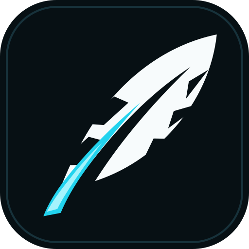
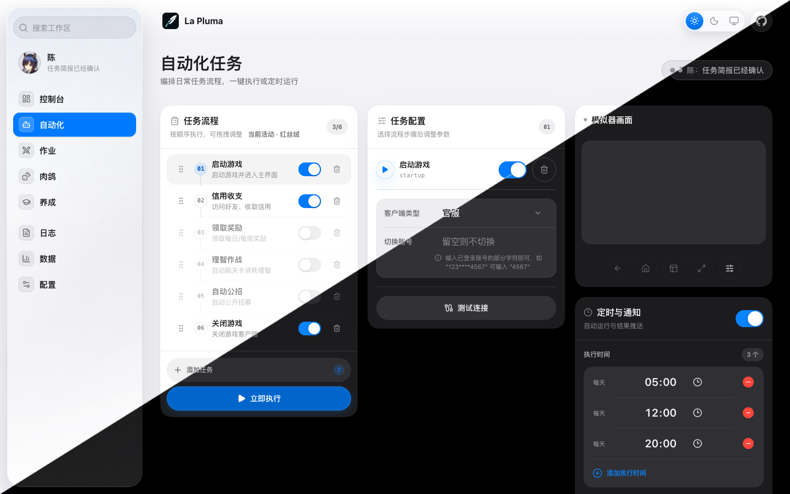
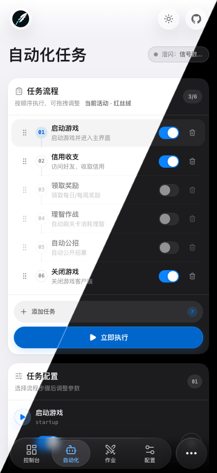

# La Pluma Next

<div align="center">
  
  <p><em>MAA CLI 的现代化 WebUI 与本地 Agent 控制台</em></p>
  
  [](https://github.com/dongwlin/La-pluma-next/actions/workflows/ci.yml)
  [](https://github.com/dongwlin/La-pluma-next/pkgs/container/la-pluma-next)
</div>

La Pluma Next 是一个面向《明日方舟》自动化的本地 Web 控制台：前端负责配置、编排和可视化，后端负责调用 `maa` CLI、ADB、ScrcpyOverWebRTC 和本地 JSON 配置，把日常任务集中到一个页面里完成。

项目主要面向 macOS 与 Linux 的本地部署：既可以直接运行源码，也可以使用 Docker 镜像；架构、设计、功能、部署与配置等说明见下方文档索引。

## ✨ 特性

以下是最常用的能力，完整功能列表见 [功能概览](docs/guides/features.md)。

- 🧭 **控制台总览** - 汇总今日活动、任务状态、实时预览和掉落信息
- 🎮 **日常任务流程** - 启动游戏、理智作战、基建换班、自动公招、信用收支、领取奖励、关闭游戏
- 🎯 **多关卡支持** - 每个关卡独立设置次数，支持活动关卡代号自动替换（HD-X → OR-X）
- 🧠 **智能检测** - 日常/芯片本开放日检测、理智耗尽自动停止、游戏状态监控
- ⏰ **定时任务** - 支持多个定时任务，实时显示执行状态和进度
- 🖥️ **模拟器预览** - 集成 ScrcpyOverWebRTC，支持网页内查看和基础设备控制
- 📊 **数据与养成** - 识别仓库和干员 Box，统计掉落，生成干员养成材料计划
- 📱 **Telegram 通知** - 任务完成后发送通知，包含截图和详细总结
- 🤖 **Bot 远程控制** - 通过 Telegram Bot 远程执行任务
- 🤖 **Agent API** - 通过 `/api/agent` 暴露 manifest/status/actions，方便 AI 或脚本调用
- 🎨 **现代化 UI 与 PWA** - React 原生 iOS 26 风格壳层 + Tailwind CSS + Framer Motion，支持深色模式；在 HTTPS 或 localhost 下可安装，离线可打开已缓存界面
- 🔄 **实时更新** - WebSocket 实时推送任务状态和日志

## 📸 界面预览

### Web 端

<p align="center">
  
  <br />
  <em>日常任务桌面端</em>
</p>

### 移动端

<p align="center">
  
  <br />
  <em>日常任务移动端</em>
</p>

## 📋 前置要求

- **操作系统**: macOS / Linux
- **Node.js** 24.12+
- **pnpm** 12.6.0（仓库通过 `packageManager` 固定版本，执行 `corepack enable` 会自动切换；也可 `npm install -g pnpm@12.6.0`）
- **MAA CLI** 已安装
  - macOS: `brew install MaaAssistantArknights/tap/maa-cli`
  - Linux: 参考 [MAA CLI 文档](https://maa.plus/docs/manual/cli/)
- 已执行 `maa install` 安装 MaaCore 及资源

## 🚀 快速开始

支持本地安装和 Docker 两种方式：本地安装适合开发调试，Docker 适合直接部署。

### 方式 1: 本地安装（推荐）

#### 1. 克隆仓库

```bash
git clone https://github.com/dongwlin/La-pluma-next.git
cd La-pluma-next
```

#### 2. 安装依赖

```bash
# 安装前端与后端依赖（在仓库根目录执行一次即可）
pnpm install
```

#### 3. 启动服务

```bash
# 同时启动前端和后端
pnpm dev

# 或分别启动
pnpm dev:client  # 前端: http://localhost:5173
pnpm dev:server  # 后端: http://localhost:3000
```

#### 4. 访问应用

打开浏览器访问 http://localhost:5173

### 方式 2: Docker 部署

使用 GHCR 预构建镜像，开箱即用。

```bash
docker pull ghcr.io/dongwlin/la-pluma-next:latest

docker run -d \
  --name la-pluma-next \
  -p 3055:3000 \
  -v /path/to/data:/app/server/data \
  -v /path/to/config:/root/.config/maa \
  -v /path/to/maacore:/root/.local/share/maa \
  -e ADB_ADDRESS=192.168.x.x:5555 \
  ghcr.io/dongwlin/la-pluma-next:latest
```

浏览器打开 http://localhost:3055。环境变量、HTTPS/PWA、子路径、Docker Compose 与本地构建见 [部署指南](docs/guides/deployment.md)。

## ⚙️ 基础配置

### ADB 连接

在「日常」页面配置 ADB 连接：

- **ADB 路径**：默认 `/opt/homebrew/bin/adb`
- **设备地址**：本地模拟器填 `emulator-5554` 或 `127.0.0.1:5555`；远程设备填 `192.168.x.x:16384`（需要开启网络 ADB）

### Telegram 通知与 Bot

在「通知设置」页面填入 Bot Token 和 Chat ID，即可接收任务完成通知并使用 Bot 远程控制。完整配置步骤、Bot 命令与运行平台说明见 [配置与跨平台支持](docs/guides/configuration.md)。

Bot 只响应配置的 Chat ID，其他用户无法控制。

## 🤖 Agent API

La Pluma Next 提供一层给 AI/Agent 使用的轻量控制接口：`/api/agent` 以语义化的 manifest/status/actions 暴露能力发现、状态读取与动作执行，Manifest 与 OpenAPI 由同一份能力清单生成，并公开每个动作的风险、dry-run、轮询和停止方式。

设置 `LA_PLUMA_TOKEN` 后，Agent API 与其它 `/api/*` 入口需要 Bearer Token 或 `X-La-Pluma-Token`。完整的接口说明、推荐执行流程、幂等与持久化约定见 [Agent API 使用指南](docs/api/agent.md)。

## 📚 文档

完整索引见 [文档索引](docs/README.md)，常用文档如下：

| 文档 | 内容 |
| --- | --- |
| [架构与技术栈](docs/architecture/README.md) | 整体架构、前端 UI 与响应式壳层、技术栈和项目结构 |
| [Agent API 使用指南](docs/api/agent.md) | manifest/status/actions、执行流程、幂等与鉴权 |
| [功能概览](docs/guides/features.md) | 控制台、自动化流程、作业与肉鸽、数据养成等详细功能 |
| [部署指南](docs/guides/deployment.md) | Docker 镜像、环境变量、HTTPS/PWA、子路径与 Compose |
| [配置与跨平台支持](docs/guides/configuration.md) | 运行平台、ADB 连接、Telegram 通知与 Bot 命令 |
| [开发文档](docs/development/README.md) | 主要技术点与常用检查命令 |
| [设计规范](DESIGN.md) | 设计原则、语义 token、布局、响应式与交互状态 |
| [通用组件库](docs/frontend/components.md) | 通用组件 API、用法与组件接入约定 |
| [维护说明](docs/development/maintaining.md) | 分支与合并、发布流程、容器镜像与兼容性标识 |

## 🤝 贡献

欢迎提交 Issue 和 Pull Request！开发环境与常用检查见 [开发文档](docs/development/README.md)，分支管理、发布流程和兼容性约定见 [维护说明](docs/development/maintaining.md)。

## 📄 许可证

本项目基于 La Pluma 开发，采用 [MIT License](LICENSE) 发布，保留上游作者的版权声明。

## 🙏 致谢

La Pluma Next 是 [La Pluma 原项目](https://github.com/mps233/La-pluma) 的社区维护分支，自 2026-10 起独立维护，不再跟随上游更新；项目名沿用《明日方舟》五星近卫干员 La Pluma（羽毛笔），上游作者：miaopasi、mps233。

- [La Pluma 原项目](https://github.com/mps233/La-pluma) - 本项目的前身
- [MAA (MaaAssistantArknights)](https://github.com/MaaAssistantArknights/MaaAssistantArknights) - 明日方舟游戏助手
- [maa-cli](https://github.com/MaaAssistantArknights/maa-cli) - MAA 命令行工具
