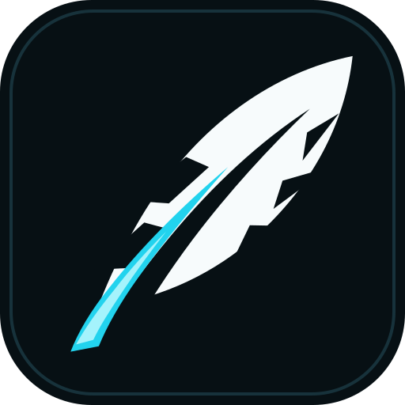
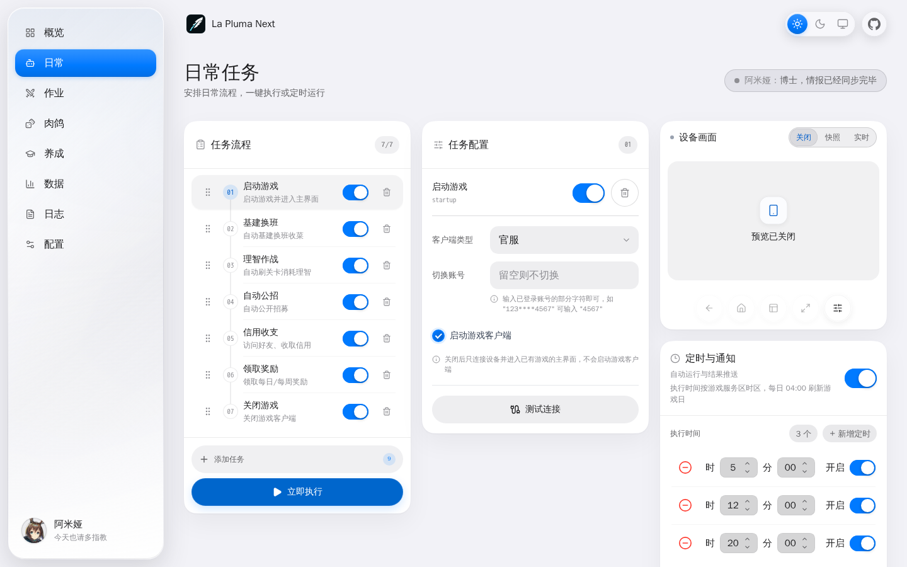
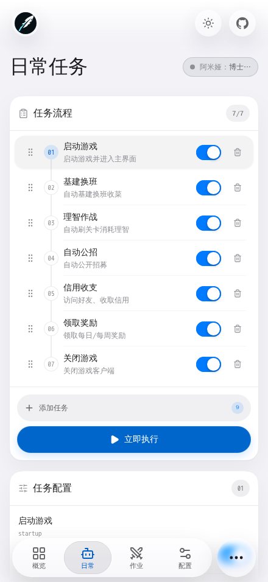

<div align="center">

  # La Pluma Next

  
  <p><em>一个基于 MAA CLI 的 WebUI</em></p>
  
  [](https://github.com/dongwlin/La-pluma-next/actions/workflows/ci.yml)
  [](https://github.com/dongwlin/La-pluma-next/pkgs/container/la-pluma-next)
</div>

## 界面预览

<p align="center">
  
  
</p>

## 快速开始

支持 Docker 与源码运行两种方式：Docker 适合直接部署，源码运行适合开发调试。

### 方式 1: Docker 部署（推荐）

使用 GHCR 预构建镜像，开箱即用。

```bash
docker run -d \
  --name la-pluma-next \
  -p 127.0.0.1:3055:3000 \
  -v /path/to/data:/app/server/data \
  -v /path/to/config:/root/.config/maa \
  -v /path/to/maacore:/root/.local/share/maa \
  -v /path/to/maa-state:/root/.local/state/maa \
  -v /path/to/webrtc:/root/ScrcpyOverWebRTC \
  -e ADB_ADDRESS=192.168.x.x:5555 \
  -e LA_PLUMA_TOKEN=change-me \
  ghcr.io/dongwlin/la-pluma-next:latest
```

`LA_PLUMA_TOKEN` 是网络访问的必配项，用于保护 `/api/*` 与 WebRTC 票据入口；请替换为足够长的随机值。上面的端口映射只监听本机回环地址；需要手机或局域网访问时，确认 token 已配置并配合防火墙后再改为 `-p 3055:3000`。

浏览器打开 [http://localhost:3055](http://localhost:3055)。环境变量、HTTPS/PWA、子路径、Docker Compose 与本地构建见 [部署指南](docs/guides/deployment.md)。

### 方式 2: 源码运行

先在本地准备好：

- **Node.js** 24+
- **pnpm** 12+
- **MAA CLI** 已安装（安装方法见 [MAA CLI 安装文档](https://docs.maa.plus/zh-cn/manual/cli/install.html)）
- 已执行 `maa install` 安装 MaaCore 及资源

```bash
git clone https://github.com/dongwlin/La-pluma-next.git
cd La-pluma-next
pnpm install
pnpm dev
```

`pnpm dev` 同时启动前端 [http://localhost:5173](http://localhost:5173) 与后端 [http://localhost:3000](http://localhost:3000)。

## 文档

完整索引见 [文档索引](docs/README.md)，常用文档如下：

| 文档 | 内容 |
| --- | --- |
| [功能概览](docs/guides/features.md) | 控制台、自动化流程、作业与肉鸽、数据养成等详细功能 |
| [部署指南](docs/guides/deployment.md) | Docker 镜像、环境变量、HTTPS/PWA、子路径与 Compose |
| [配置与跨平台支持](docs/guides/configuration.md) | 运行平台、ADB 连接、Telegram 通知与 Bot 命令 |
| [Agent API 使用指南](docs/api/agent.md) | manifest/status/actions、执行流程、幂等与鉴权 |
| [架构与技术栈](docs/architecture/README.md) | 整体架构、前端 UI 与响应式壳层、技术栈和项目结构 |
| [开发文档](docs/development/README.md) | 主要技术点、样式与测试治理、常用检查命令 |
| [维护说明](docs/development/maintaining.md) | 分支管理、发布流程、兼容性标识与文档归属 |

## 贡献

欢迎提交 Issue 和 Pull Request！

## 许可证

本项目基于 La Pluma 开发，采用 [MIT License](LICENSE) 发布，保留上游作者的版权声明。

## 致谢

La Pluma Next 是 [La Pluma](https://github.com/mps233/La-pluma) 的社区维护分支，自 2026-10 起独立维护，不再跟随上游更新。

- [MAA (MaaAssistantArknights)](https://github.com/MaaAssistantArknights/MaaAssistantArknights) - 明日方舟游戏助手
- [maa-cli](https://github.com/MaaAssistantArknights/maa-cli) - MAA 命令行工具
